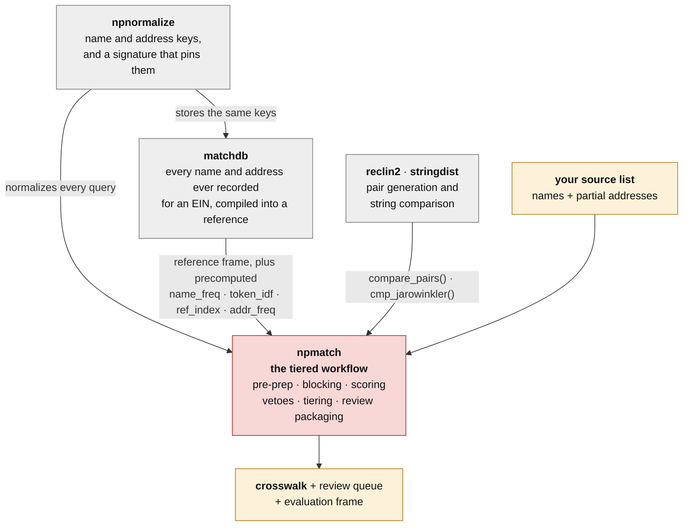

# npmatch

A tiered workflow for matching organization records to a reference database when
no shared identifier is available.

npmatch is not a single matching algorithm. It is the **harness that manages the
steps** of a match — enumerating the names an entity is known by, standardizing
both sides, precomputing the corpus statistics that make a token informative,
generating candidates, adjudicating them into tiers, and packaging what is left
for a human or an LLM. Those steps are generic. The nonprofit case npmatch ships
wired for — federal registrants (SAM / USASpending) to the IRS Business Master
File — is one deployment of the framework, not its definition; the same six
tiers are deployed elsewhere, such as
[pfmatch](https://github.com/Nonprofit-Open-Data-Collective/pfmatch) matching
990-PF grant recipients.

## The stack

npmatch owns the workflow and borrows every part that is better owned elsewhere:
the normalizer, the alias database, and the pair-generation engine each live in
their own package.



| package | role | why it is separate |
|---|---|---|
| [**npnormalize**](https://github.com/Nonprofit-Open-Data-Collective/npnormalize) | turns names and addresses into match keys, and fingerprints the code that made them | both sides of a match must be normalized by the *same* code, or matches quietly stop being found. One package holds it; `np_normalize_signature()` makes a mismatch an error instead of a silent loss. Imported, and re-exported here unchanged. |
| [**matchdb**](https://github.com/Nonprofit-Open-Data-Collective/matchdb) | alias enumeration: every name and address the IRS and 990 filers have recorded for each EIN, compiled on demand into a reference frame | an organization's *legal* name is often not the name a source list wrote down. Enumerating aliases is a data-curation problem with its own cadence and its own 10 GB, not a matching problem. Recognized by shape, so it is not a formal dependency. |
| [**reclin2**](https://cran.r-project.org/package=reclin2) · [**stringdist**](https://cran.r-project.org/package=stringdist) | pair generation and field-level string comparison | mature implementations of the mechanical part. npmatch supplies the blocking that keeps the pair set tractable and the scoring that interprets the comparisons. Under `Suggests`; install them before running a match. |

## Installation

```r
# install.packages("remotes")
remotes::install_github("Nonprofit-Open-Data-Collective/npmatch")         # development version
remotes::install_github("Nonprofit-Open-Data-Collective/npmatch@v0.1.1")  # the last release
remotes::install_github("Nonprofit-Open-Data-Collective/npmatch@v0.1.0")  # v0, the crosswalk release
```

npnormalize installs with npmatch (from GitHub, via `Remotes:`). Add matchdb to
download a published reference, and reclin2 + stringdist to run a match:

```r
remotes::install_github("Nonprofit-Open-Data-Collective/matchdb")
install.packages(c("reclin2", "stringdist"))
```

### Releases and reproducibility

The current release is **0.1.1**, git tag
[`v0.1.1`](https://github.com/Nonprofit-Open-Data-Collective/npmatch/releases/tag/v0.1.1).
It is the last version that carries its own normalizer; the development version
imports it from npnormalize. The first release, **v0 (0.1.0)**, pins the code
behind the combined 2025NOV + 2026MAY SAM-to-BMF crosswalk. See
[NEWS.md](NEWS.md) for what each contains and their known issues.

Pin a release in any analysis that must reproduce its results exactly. `main`
keeps changing, and a change to normalization, blocking or scoring changes which
EINs are matched. `packageVersion("npmatch")` reports the release number, and a
`.9000` suffix for the development version.

Pin the **normalizer** too. `np_normalize_signature()` fingerprints the code
that builds the keys, and every stored artifact — a cached normalized reference,
a matchdb bundle — carries the signature it was built under. npmatch refuses a
reference whose signature differs from the installed npnormalize's, rather than
matching against keys it cannot reproduce. Record the signature your run
reported; do not copy one out of documentation, because it changes whenever the
rules do.

## The six tiers

Each tier is a separable concern with its own failure mode. A deployment can
replace any one of them — a different alias source, a different scorer, a
different reviewer — without touching the others.

| # | tier | owner | npmatch entry points |
|---|---|---|---|
| 1 | **alias enumeration** — every name and address the entity is known by | matchdb | `np_cascade()`, `np_run_batches()` and `np_stage1_run()` take a matchdb reference as `reference` |
| 2 | **input standardization** — names and addresses onto common keys | npnormalize | `np_query()` / `np_reference()` → `np_normalize()` |
| 3 | **data pre-prep** — tokenization, inverse document frequency, name and address frequency | npmatch, or precomputed by matchdb | `np_ref_index()`, `np_token_idf()`, `np_name_freq()`, `np_addr_freq()` |
| 4 | **candidate generation** — blocking, then fuzzy comparison | npmatch + reclin2 | `np_block()`, `np_block_union()`, `np_compare()` |
| 5 | **tiered adjudication** — score, veto, select, sort into YES / MAYBE / NO | npmatch | `np_score()`, `np_veto()`, `np_select()`, `np_tier()` |
| 6 | **packaging for review** — spreadsheets, LLM prompts, reports | npmatch | `np_route()`, `np_label_frame()`, `np_as_prompt()`, `np_review_report()` |

`np_cascade()` orchestrates tiers 2–5 end to end as progressive passes (the
scalable path) and `np_match()` in a single pass; `np_route()` then does tier 6
on the result. The stage drivers
(`np_stage1_run()` … `np_final_run()`) wrap that in an on-disk run project, with
tiers 5 and 6 handing off to LLM adjudication and research stages. See the
[Workflow article](https://nonprofit-open-data-collective.github.io/npmatch/articles/workflow.html).

```
source records -> np_normalize -> np_block -> np_compare -> np_score -> np_veto -> np_select -> np_tier -> np_route
```

## Quick start

The reference side comes from matchdb, which ships the pre-prep of tier 3
already computed:

```r
library(npmatch)

b <- matchdb::md_reference("active-observed", fetch = "missing")   # ~260 MB, once
res <- np_cascade(my_query, b)                                     # frame + its precomputed tables
out <- np_route(res)

out$accepted      # the auto-matched crosswalk (YES)
out$review        # the MAYBE queue, one row per candidate
out$unmatched     # the NO tier, each with its best near-miss
```

Passing the matchdb object as `reference` is the shortest path: npmatch takes
its frame plus whichever of `name_freq`, `token_idf`, `ref_index` and
`addr_freq` it carries instead of recomputing them, and refuses it outright if
it was built by a different normalizer. Any data frame works too — a plain BMF
extract, a state registry, a membership list — in which case npmatch computes
the tier-3 tables itself.

For a large source, `np_run_batches()` chunks the query, caches the normalized
reference and its tables, and writes per-chunk outputs that can be resumed.

### Data sources, and what is pre-wired

| side | pre-wired source | what else fits |
|---|---|---|
| **query** | USASpending / SAM registrants, keyed by `uei` — `np_map_sam()`, `np_prepare_sam()` | any list of organization names with variable geographic detail; supply a schema map |
| **reference** | matchdb bundles (default), or a standardized IRS EO Business Master File from NCCS, keyed by `ein` — `np_map_bmf()`, `np_fetch_bmf()` | any reference frame with a name, an address and an id |

The SAM and BMF helpers are conveniences for the deployment npmatch was built
for, not requirements of the framework. `np_query(df, map)` / `np_reference(df,
map)` rename any dataset's columns onto the canonical schema (`name`, `dba`,
`division`, `street`, `city`, `state`, `zip5`, `.id`), and every tier downstream
works on those names alone.

---

# The pipeline in detail

Each section below lists the internal subroutines a stage calls and its ordered
process steps, with the function that performs each step noted as `:: fx()`.

## Tier 2 · `np_query(df, map)` / `np_reference(df, map)` — canonicalize

Rename raw source columns onto the canonical schema so every downstream stage
works on common column names.

**subroutines**

- `.np_canonicalize()` :: apply a schema map (`np_map_sam()` / `np_map_bmf()`) that maps canonical fields (`name`, `dba`, `division`, `street`, `city`, `state`, `zip5`, `.id`/`.ein`) to source columns

**process:**

1. map each source column onto its canonical field :: `.np_canonicalize()`
2. fill any unmapped canonical field with `NA` and squish white space :: `.np_canonicalize()`

## Tier 2 · `np_normalize(df)` — standardize names and addresses

Lives in
[npnormalize](https://nonprofit-open-data-collective.github.io/npnormalize/)
and is re-exported here unchanged, so `npmatch::np_normalize()` and anything
built on it keeps working. It brings names and addresses onto a common
matchable form and extracts the token-level features the veto layer needs.
npnormalize's own documentation is authoritative on the rules; what matters
downstream is the columns it adds:

- **name keys** — `name_key` (the match key: cleaned, abbreviations expanded,
  leading `THE` and trailing legal suffixes stripped), `name_full` (suffix
  retained), `name_core`, `dba_key`, `division_key`
- **name features the veto layer reads** — `name_form` (the detected legal form),
  `name_nums` (embedded chapter / local numbers), `name_ord` (ordinals folded to
  a rank), `name_dir` (directionals canonicalized), `name_placeholder`
- **address parts** — `street_key` (USPS-standardized, suite removed),
  `street_num` / `street_name` / `street_type`, `street_unit` and
  `street_unit_id` (the identifier alone, so `STE D-2` and `Suite D2` agree),
  `is_po_box`
- **ZIP and state** — `zip5`, `zip3`, `zip9` as a nested prefix family, and
  `state_abb`

Two decisions worth knowing because they are worth real recall: apostrophes are
**deleted, not spaced** (the BMF holds `ST LUKES`, so `ST LUKE S` would never
clear an exact-name pass), and letters with no accent to drop are folded to
their ASCII spelling (`ß` → `SS`, `Ø` → `O`, `Æ` → `AE`, `Þ` → `TH`) rather than
being replaced by a space that splits the word.

`name_gen` / `name_gen_rank` (a `JR`/`SR` generation marker) are **vestigial** —
a person-name concept from the SAM / USASpending lineage. Organizations do not
have generations, nothing consumes the columns, and they are retained only so
existing labeled extracts keep their layout.

## Tier 3 · corpus statistics — what makes a token or an address informative

Distinctiveness is a property of the reference corpus, not of a pair, so these
tables are built once over the whole reference and reused by every pass, batch
and worker. `np_cascade()` builds any that are missing; matchdb's bundles ship
them precomputed, counted over exactly the bundle's rows.

- `np_name_freq()` :: how many reference records share each exact `name_key`. An
  exact match to a name held by one organization is trustworthy with no address
  corroboration; an exact match to `FIRST BAPTIST CHURCH` is not.
- `np_token_idf()` :: per-token `log(N / df)`. Rare tokens are what name-token
  blocking leverages; corpus-common tokens are not.
- `np_addr_freq()` :: how many records share an address, and an address + suite,
  how many distinct suites an address carries, and **what kind of place it is** —
  `federated` (thousands of chapters filing from one national office, where the
  address is anti-evidence), `sponsor` (a fiscal sponsor or registered agent,
  where it is noise), `multi_tenant` (where a suite match is real evidence).
- `np_ref_index()` :: the tokenized reference, built once rather than per pass.

Pass a table counted over the **full** reference when matching against part of
it (one state, say) via `addr_freq =` / `name_freq =` / `token_idf =`, so
crowded addresses and common names are not under-counted. A per-slice table
shifts scores with no error — the quiet kind of failure.

## Tier 4 · `np_block(query, reference)` — generate candidate pairs

Produces only the (query, reference) pairs worth comparing, so `np_compare()`
never scores every same-state pair. This is where **inverse document frequency
(IDF) tokenization** lives.

**subroutines**

- `.np_bykey()` :: build a composite exact-block key (e.g. `state`, or `state` + `name_key`)
- `np_stopwords()` :: the non-discriminating tokens dropped before token blocking
- `np_token_idf()` :: per-token IDF, `log(N / df)`, over the reference corpus

**process:**

1. build candidate pairs that share an exact block key (hash join), OR tokenize each name and index it, dropping stopwords and sub-2-character tokens :: `idx_of()`
2. drop corpus-common tokens whose reference document frequency exceeds `max_ref_freq`
3. **tokenize by inverse document frequency**: keep a pair only when the sum of its shared tokens' IDF clears `min_pair_idf`, so one rare token (or several moderately common ones) justifies a pair but a lone common token (e.g. `CALIFORNIA`, `CHURCH`) does not
4. de-duplicate the pairs from several passes :: `np_block_union()`

`np_cascade()` runs blocking as **progressive passes** — exact name, exact name/DBA, exact
DBA/name, exact DBA/DBA, shared-token same-state, shared-token cross-state — pruning each
query out of later (looser, costlier) passes once it is resolved (**residual pruning**).

## Tier 4 · `np_compare(query, reference)` — per-field similarity

**subroutines**

- `reclin2::compare_pairs()` with `cmp_jarowinkler()` / `cmp_identical()` :: per-field comparison
- `.np_name_overlap()` :: token-set + acronym-aware overlap (word-reorder, `EMS` <-> `Emergency Medical Service`)
- `.np_collapse_initials()` :: collapse single-letter runs (`F O R` -> `FOR`)
- `np_name_freq()` :: how many reference records share a normalized name
- `np_addr_freq()` :: how many reference records share an address, and an address + suite, and how many distinct suites an address carries — what makes a suite match informative (a multi-tenant building) or meaningless (a fiscal sponsor's mail drop)

**process:**

1. compare the name on `name_key` with Jaro-Winkler :: `cmp_jarowinkler()`
2. floor fuzzy similarities below `jw_threshold` to 0 (Winkler is a prefix *boost*, not a cutoff)
3. compare geo fields — fuzzy city/street (JW) and exact ZIP :: `cmp_jarowinkler()` / `cmp_identical()`
4. compute exact geo signals: ZIP9 / ZIP5 / ZIP3 / state / street-number / PO-box matches :: `exact()`
5. effective name similarity = best of the name / DBA / division cross-products (name vs name, name vs DBA, DBA vs name, DBA vs DBA, division vs name, division vs DBA)
6. name-blind recovery: token-set + acronym overlap when JW and DBA both score 0 **and** the address is confirmed :: `.np_name_overlap()`
7. record which name **version** matched on each side (`main` / `dba` / `division` / `token_overlap` / `none`)
8. compute the name distinctiveness count (`normalized_match_count`) :: `np_name_freq()`

## Tier 5 · `np_score(pairs, method = "hier")` — combine into one score

**subroutines**

- `.np_hier_score()` :: name similarity + a hierarchical geo sub-score

**process:**

1. name sub-score = the effective name similarity from `np_compare()`
2. geo sub-score = the **strongest confirmed** location granularity via `max`, not a sum (`ZIP9 > street > ZIP5 > PO box > ZIP3 > city > state`), so correlated address fields are not double-counted :: `.np_hier_score()`
3. combine: `score = 0.6 * name + 0.4 * geo`
4. distinctive-exact-name promotion: an exact match on a rare name is floored up so it auto-accepts without address corroboration — **state-aware**: cross-state name-only matches get a lower floor and land in MAYBE for review :: `.np_hier_score()`

## Tier 5 · `np_veto(pairs)` — do-not-match rules

**subroutines**

- `.np_rule_number()` / `.np_rule_ordinal()` / `.np_rule_direction()` / `.np_rule_forprofit()` :: hard predicates
- `.np_rule_affiliate_suffix()` / `.np_rule_government()` :: soft predicates

**process:** every rule in `config$rules` runs on every pair; hits accumulate by severity (`;`-separated when more than one fires). A **hard** hit means impossible — `np_select()` drops the pair, so that EIN is out of contention. A **soft** hit means plausible-but-review — the pair stays eligible, and if it is the selected match `np_tier()` caps it at MAYBE.

1. number conflict — disjoint embedded numbers (`Local 32` vs `Local 45`) -> **hard** :: `.np_rule_number()`
2. ordinal conflict — `FIRST` vs `SECOND` -> **hard** :: `.np_rule_ordinal()`
3. direction conflict — `SOUTHWEST` vs `SOUTHEAST` -> **hard** :: `.np_rule_direction()`
4. for-profit form — query's raw name ends in `LLC` / `LP` / `LLP` / `PLLC` -> **hard** (no exempt org uses these) :: `.np_rule_forprofit()`
5. affiliate-suffix mismatch — query `X` matched to candidate `X FOUNDATION` on a strong name match -> **soft** (cap at MAYBE) :: `.np_rule_affiliate_suffix()`
6. government entity — query is a municipality / school district / special district / authority -> **soft** :: `.np_rule_government()`
7. add `veto` / `veto_reason` (hard) and `veto_soft` / `veto_soft_reason` (soft)

Why the layer exists: fuzzy similarity is worst exactly where org names differ by one short decisive token. `First Presbyterian Church` and `Second Presbyterian Church` are ~95% similar as strings and are two different congregations — likewise `Southwest` vs `Southeast Community Center`, `Local 32` vs `Local 45`, and an org vs its fundraising foundation. Scorer tuning cannot separate those; the rules encode the token as a constraint instead.

Steps 4 and 6 fold the old Tier-1 legal-form / entity screen into the cascade. `legal_form_conflict` (INC vs CORP) ships **inactive** — enable with `rbind(np_default_rules(), np_rule_legal_form())`. The internal generation predicates (`.np_rule_generation*`, Jr vs Sr) are **vestigial and must not be wired in or cited as examples**: generational suffixes distinguish two *people*, not two organisations, and are an artifact of the SAM / USASpending person-matching lineage. Rules 1–6 are the organisation-level equivalents.

## Tier 5 · `np_select(pairs)` — best candidate per query

**subroutines**

- `.np_overall_summary()` :: the overall pick with tie-aware tiebreaking
- `.np_argmax_by()` :: best row per query for a given column
- `.np_full_name_sim()` :: break a high tie by full-name similarity

**process:**

1. drop hard-vetoed pairs
2. pick the overall best by combined `score`; when several tie near the top, break the tie by full-name similarity :: `.np_overall_summary()`
3. also surface the best **name-only** and best **address-only** view (disagreement widens the review set) :: `.np_argmax_by()`
4. compute the runner-up margin — the lead over the next-best distinct entity
5. flag near-ties (`n_close`, `tie`) and whether the views agree (`views_agree`)

## Tier 5 · `np_tier(selection)` — YES / MAYBE / NO

**process:**

1. `score >= yes` -> **YES**; `>= maybe` -> **MAYBE**; else **NO**
2. demote YES -> MAYBE on a near-tie (`overall_margin < min_margin`) — genuine ambiguity
3. demote YES -> MAYBE on a soft veto on the selected pair (`affiliate_suffix`, `government_entity`) — never demotes MAYBE to NO

## Tier 6 · `np_route(tiered)` — hand-off products

**subroutines**

- `.np_candidates()` :: surface top-k by score plus the best name-only and best address-only pairs
- `.np_review_layout()` / `.np_rename_review()` :: assemble the human review / evaluation frame
- `np_bmf_review_fields()` :: import reference context (for the BMF: NTEE, subsection, foundation flag, ruling year, assets/revenue, 990 form type, affiliation, group exemption)
- `np_token_idf()` :: annotate the tokenized name fields with each token's rarity

**process:**

1. **`accepted`** — the auto-matched crosswalk (YES tier)
2. **`review`** — the candidate-level evaluation spreadsheet: match strength + outcome (`match_decision`, `is_top_candidate`, `match_layer`, `decision_reason`, veto flags), the name-match summary and cleaning progression, the aligned address fields, and the imported reference context — the same schema a human sheet and an LLM prompt (`np_as_prompt()`) both consume
3. **`unmatched`** — the NO tier, each with its best near-miss for reference
